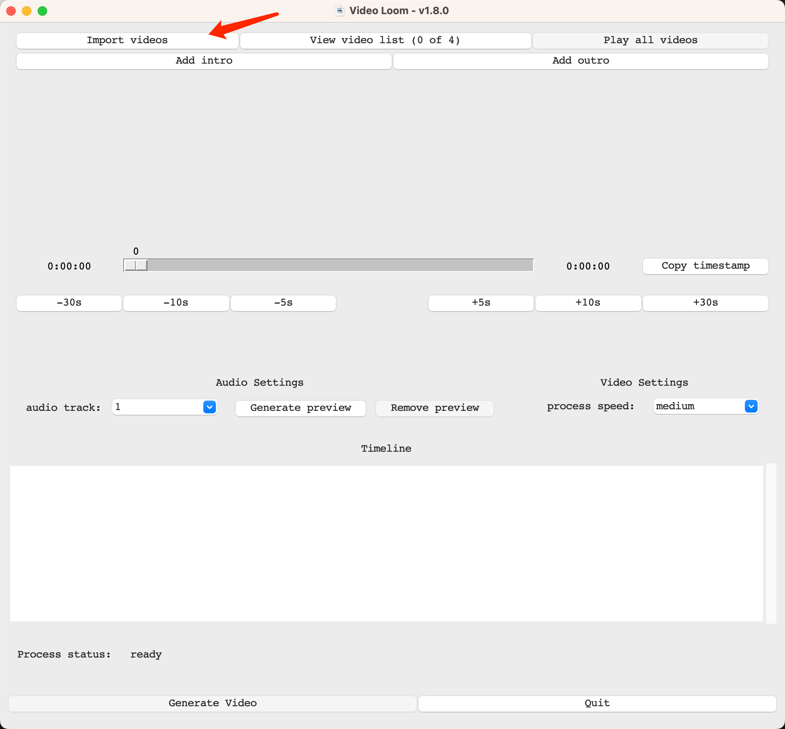
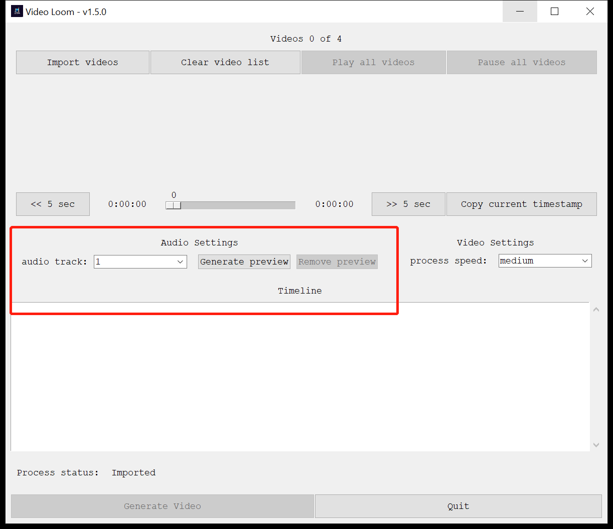
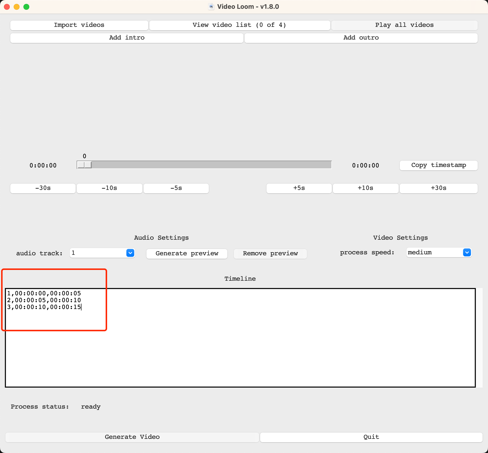
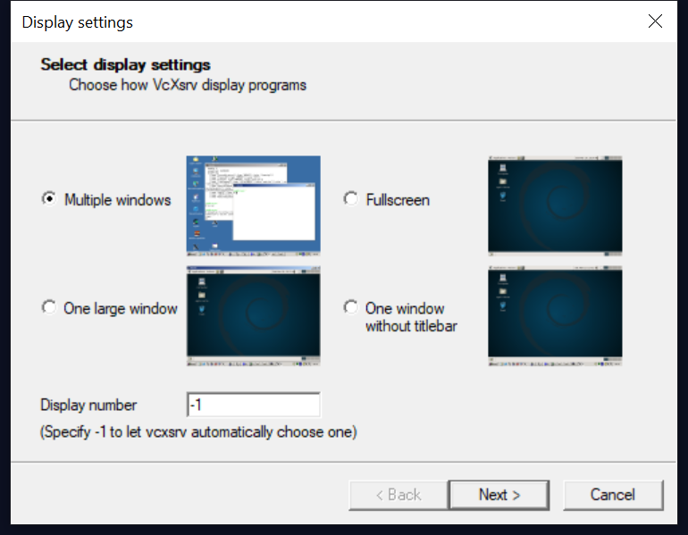
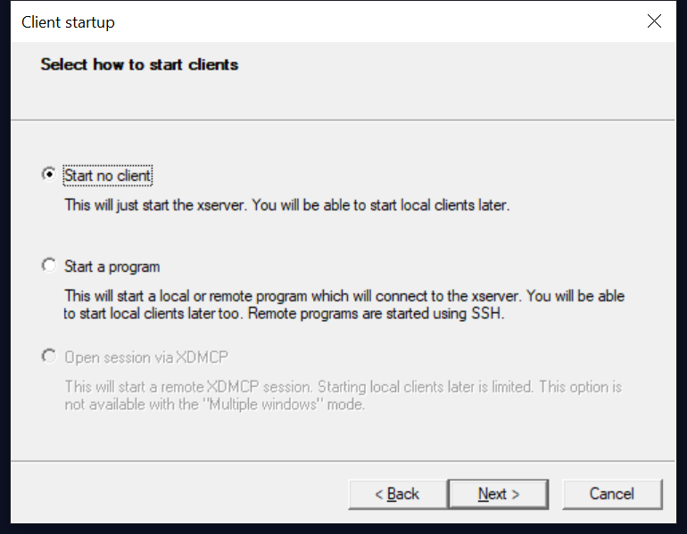
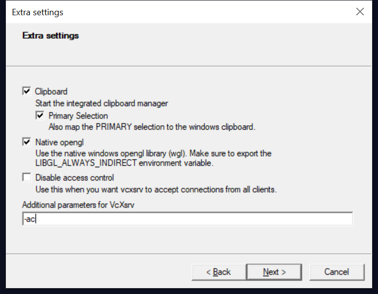
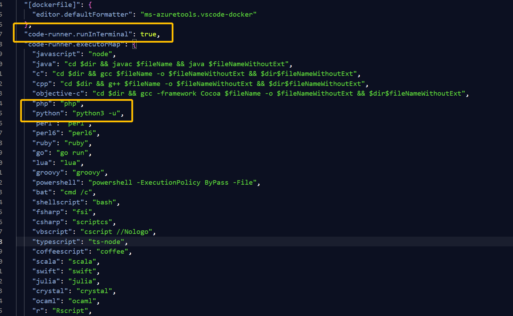

# VIDEO LOOM

<p align="center">
  
</p>

## What does Video Loom do?

Video Loom is a portable, multi-platform application that helps you trim and combine videos. Say you have 4 cameras shooting a scene simultaneously—Video Loom can cut these videos by timestamps and combine them into a dynamic final product. Try it out!

## User guide

> Before starting to use the software, ensure the following software is installed on your local machine.
>
> **Windows** - `chocolatey` and `ffmpeg`
>
> - For NVIDIA graphics card users, the minimum required NVIDIA driver for NVENC is 522.25 or newer
> - Python v3.9+
>
> **macOS** - `ffmpeg`

### Windows

#### How to install `chocolatey` on Windows

1. Open PowerShell on Windows with administrator access
2. In PowerShell, type `Set-ExecutionPolicy AllSigned`, then press Enter
3. Execute this command:

   ```powershell
   Set-ExecutionPolicy Bypass -Scope Process -Force; [System.Net.ServicePointManager]::SecurityProtocol = [System.Net.ServicePointManager]::SecurityProtocol -bor 3072; iex ((New-Object System.Net.WebClient).DownloadString('https://community.chocolatey.org/install.ps1'))
   ```

#### How to install `ffmpeg` on Windows

1. Open PowerShell on Windows with administrator access
2. In PowerShell, type `choco install ffmpeg-full`, then press Enter
3. Wait until the installation process is complete
4. (Optional) To verify `ffmpeg` is installed, reopen another PowerShell terminal and type `ffmpeg`, then press Enter. You should not see any error messages.

### macOS

#### How to install `ffmpeg` on macOS

1. In Terminal, run `brew install ffmpeg`

### How to run the application

1. Download the `.exe` (Windows) or `.app` (macOS) file from [here](https://github.com/shihanxiong/video_loom/tree/main/src/dist)
2. Open the application
3. Click on the "Import files" button and start importing videos (up to 4)
   - 
4. Click on "Play all videos" and "Pause all videos" to play all video files simultaneously
   - Use skip -5 / +5 buttons to skip backward and forward
   - (Optional) If you want to play videos with audio: Choose an audio track, then click on the "Generate preview" button under "Audio settings"
     - 
     - Wait until the application prompts you that the preview generation is complete. Now when you play videos, you can hear the audio from the videos simultaneously
5. In the text box, type in the segments of the videos you want to trim

   - Example: If you'd like to use 0:00:00 - 0:10:00 from video 1, and 0:10:00 - 0:15:05 from video 2, then the text would look like (as shown below):

   ```bash
   1,0:00:00,0:10:00
   2,0:10:00,0:15:05
   ```

   - 

6. Select the audio you would like to use for the final video
7. Click "Generate video" to start generating the final output. The output file will be in `.mp4` format and named after the current timestamp

## Environment setup (for developers)

### Windows (WSL2)

1. In order to allow rendering in WSL2, we need to ensure Xming is installed
2. Before starting development, launch the application "XLaunch"
3. Follow the steps below. For `Additional parameters for VcXsrv`, type `-ac`:
   
   
   

4. After the above steps, click `Finish` and launch Xming
5. Once Xming is launched, we'll need to configure the `$DISPLAY` variable to point to the local machine's IP. To do that, open a terminal and follow the steps below:

```bash
$ cat /etc/resolv.conf

# This is what you will see:
# # This file was automatically generated by WSL. To stop automatic generation of this file, add the following entry to /etc/wsl.conf:
# # [network]
# # generateResolvConf = false
# nameserver 172.27.176.1

$ export DISPLAY=172.27.176.1:0  # Ensure :0 is appended at the end
```

6. (Optional) If you are running the application using `code-runner` in VS Code, you can configure `"code-runner.runInTerminal": true` in `settings.json`, as well as setting the `python` command as `python3 -m`. See below:

   

   (If you are seeing errors related to `$DISPLAY`, make sure to run `export DISPLAY=172.27.176.1:0` in your VS Code terminal)

7. Now you can run `python3 <app_name>.py` to execute programs

## Install dependencies

```bash
# Ensure Python 3.9+ is installed
# Install pip dependencies

$ pip3 install -r requirements.txt
```

## Testing

```bash
# Running tests
$ pytest -vvs
```

## Packaging

```bash
# Generate executables
# Note: Executables will automatically be determined by the OS (e.g., '.exe' for Windows and '.app' for macOS)

$ cd src
$ ./bundle.sh <app.win32.spec | app.macos.spec> <v_[major][minor][patch]>
# Example: ./bundle.sh app.win32.spec v1.9.13
```

## Changelog

> Changelog can be found [here](changelog.md)
